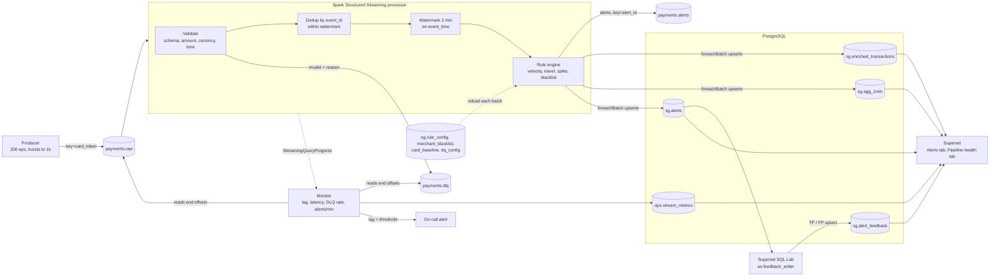

# StreamGuard — Design Decisions (v0.1)

## 1. Problem
Fraud on card payments is caught hours late from a next-morning batch report. We need a Kafka/Spark pipeline that validates events, applies configurable fraud rules within seconds, stores alerts idempotently, and records analyst feedback.

## 2. Gaps, ambiguities and proposed defaults

| # | Gap | Proposed default |
|---|-----|------------------|
| 1 | **Allowed currencies** | `INR, USD, EUR, GBP, SGD, AED`, stored in `sg.dq_config.allowed_currencies` (defaults in `config/dq.yaml`). Any other currency goes to the DLQ with reason `CURRENCY_NOT_ALLOWED`. *(Changed 2026-11-20, see D-13.)* |
| 2 | **Amount ceiling**, and whether amounts in different currencies can be compared | No FX conversion. The ceiling is a flat 500,000.00 (`sg.dq_config.amount_ceiling`, sized for INR, the main currency), compared with `amount` as sent, in the event's own currency. An amount ≤ 0 or above the ceiling goes to the DLQ (`AMOUNT_OUT_OF_RANGE`). For other currencies this is only a loose sanity bound, and `sg.agg_1min.amount_sum` adds amounts across currencies, so it is a volume indicator, not money. *(Changed 2026-11-20, see D-13.)* |
| 3 | **Seeding the 30-day average** for synthetic cards | A seed script writes `sg.card_baseline(card_token, avg_amount_30d, tx_count_30d, updated_at)` from 30 days of generated history. The producer draws amounts from each card's profile. A nightly batch job refreshes the profile; the stream never updates it. The average uses whatever history the card has in the last 30 days, even 1 or 2 transactions: with 1 prior transaction the average is that amount, with 2 it is their mean. The rule is skipped only when `tx_count_30d = 0`, because there is nothing to compare against. Keeping the profile fixed during a run makes replays deterministic. |
| 4 | **Events later than the 2-minute watermark** | Spark drops them from stateful operators without any error, so lateness is checked explicitly against the watermark. Late events get reason code `LATE_EVENT` and `is_late=true` and are still written to `sg.enriched_transactions`. They are excluded from the windowed rules (velocity, travel); per-event rules (blacklist, amount spike) still run. The `late_events_total` metric counts them. They are not sent to the DLQ, because they are valid data. |
| 5 | **Feedback entry** | In Superset, no separate app. Analysts use a second Superset database connection that logs in as `feedback_writer`, with *Allow DML* enabled on that connection only, and upsert into `sg.alert_feedback(alert_id PK, label TRUE_POSITIVE/FALSE_POSITIVE, analyst, noted_at, comment)` from SQL Lab. `feedback_writer` can use only `sg.alert_feedback` (SELECT, INSERT, UPDATE; PostgreSQL needs SELECT for `ON CONFLICT ... DO UPDATE`). A trigger sets `sg.alerts.status = 'CLOSED'`. The dashboard connection (`superset_ro`) stays read-only. *(Changed 2026-11-20, see D-13.)* |
| 6 | **Velocity window type** | A sliding window per card, evaluated on every event: count of events in `(t − 60s, t]` > 5. Implemented as SQL in `sql/rules/` that runs in PostgreSQL against `sg.enriched_transactions` for the cards in each micro-batch, so it is testable without Spark. The travel rule uses the same approach with a 30-minute lookback. Tumbling windows would miss bursts that straddle a minute boundary. |
| 7 | **Alert dedup key per rule** | `alert_id = sha256(rule_id ‖ key)`. **Velocity:** `card_token ‖ minute_floor(trigger_event_time)` (at most 1 alert per card per minute). **Impossible travel:** `card_token ‖ trigger event_id`. **Amount spike:** `event_id`. **Blacklist:** `event_id`. |
| 8 | **Dedup state lifetime** | Within a micro-batch, Spark drops duplicate `event_id`s (`dropDuplicatesWithinWatermark`, about 2 minutes of state). Across batches and replays, `sg.enriched_transactions.event_id` is the primary key with `ON CONFLICT DO NOTHING`, and rules run only on rows actually inserted. When duplicates disagree, the first one wins. |
| 9 | **Rule config source and reload** | A `sg.rule_config(rule_id, name, enabled, severity, params JSONB, version, updated_at)` table and a `sg.merchant_blacklist` table. A trigger bumps `version` on every real change. The processor re-reads both every micro-batch. Each alert stores `rule_version`. Defaults are in `config/rules.yaml`; `scripts/apply_sql.py` inserts them, keeps runtime edits on re-run, and restores them with `--reset-config`. *(Changed 2026-11-20, see D-13.)* |
| 10 | **Which `status` values the rules evaluate** | All statuses, because declines are a fraud signal. `status` is copied onto the alert as `txn_status`. |
| 11 | **Time semantics** | `event_time` is UTC ISO-8601 with milliseconds. An event more than 24h in the future goes to the DLQ (`FUTURE_EVENT_TIME`). The processor adds `ingest_time`, and latency = `processed_at − event_time`. |
| 12 | **Definitions of "backlog" and "precision"** | Backlog = alerts with no feedback, also shown split into those older than 15 minutes. Daily precision per rule = TP / (TP + FP), grouped by the day the alert was created. Unreviewed alerts are shown separately and not counted as FP. |
| 13 | **Database layout** (added 2026-11-20) | Schema `sg` holds business tables (`sql/ddl/01_sg.sql`) and schema `ops` holds observability (`sql/ddl/02_ops.sql`); views are in `sql/views/`, seed data in `sql/seed/`; `scripts/apply_sql.py --db <name>` applies all of it in one transaction and is safe to re-run. Renames from the first draft: `enriched_txn` → `sg.enriched_transactions`, `fraud_rule` → `sg.rule_config`, `card_profile` → `sg.card_baseline`, and `sg.agg_1min` is keyed by `(window_start, channel, country)` instead of merchant category. `sg.alerts` has `status` `OPEN/CLOSED` (analyst state) and `txn_status` (payment status, D-10). `sg.dlq_events` is unique on `(source_topic, kafka_partition, kafka_offset)`. Lag, latency and backlog thresholds are in `ops.health_config` (defaults in `config/dq.yaml`, `LAG_ALERT_THRESHOLD` / `LATENCY_ALERT_SECONDS` from `.env` override them). `ops.v_pipeline_health` reads them from there. |

## 3. Delivery guarantees: at-least-once + idempotent writes vs exactly-once

**What Spark actually guarantees**
- **Kafka source:** offsets are stored in the checkpoint. After a crash, Spark re-reads exactly the same offset range for the failed micro-batch.
- **`foreachBatch`:** at-least-once. A batch can run again with the same `batchId`. A Postgres-only sink can become effectively-once after a crash by committing the data and `batchId` in one transaction. That does **not** cover operator replays: a new checkpoint or offset reset restarts batch IDs and changes batch boundaries.
- **Kafka sink:** **at-least-once only**. Spark's Kafka writer does not use Kafka transactions. Producer retries or a batch that runs again will write **duplicate records**.
- **Two sinks in one `foreachBatch` cannot be atomic.** We write to Postgres first (one transaction), then to Kafka. If the job crashes between the two, the batch runs again: the Postgres write does nothing, and Kafka gets duplicates.

**What exactly-once would cost**
- A custom transactional Kafka producer inside `foreachBatch`, plus `read_committed` consumers. This is still not atomic with Postgres, because there is no two-phase commit across the two.
- Or the outbox pattern: Spark writes only to Postgres, and Debezium or a relay publishes alerts to Kafka. This adds a component to build and operate.
- Or switching engine to Flink, which has two-phase-commit sinks. That is out of scope.

**Decision: at-least-once with idempotent writes.**
- The `sg.alerts` table has `alert_id` as its primary key and uses `ON CONFLICT DO NOTHING`. This keeps the first `alert_time` and any analyst state.
- `sg.enriched_transactions` uses `event_id` as its primary key.
- `sg.agg_1min` uses `(window_start, channel, country)` as its key and is upserted with **absolute values from state**. It never uses `count = count + excluded.count`.
- `payments.alerts` is keyed by `alert_id` and log-compacted, so duplicates collapse. Consumers deduplicate by key.

**What a replay does** (offset reset, or a new checkpoint with `startingOffsets`):
- Spark re-reads `payments.raw` and rebuilds its dedup state. Rule SQL reads `sg.enriched_transactions`, where replayed events already exist.
- With the same rule version and profile snapshot, it produces the same `alert_id`s. Postgres ends up with no new rows, and Kafka gets duplicates that compaction removes.
- Caveats:
  - Different micro-batch boundaries can change which events count as late. The replay test therefore uses `Trigger.AvailableNow` on a bounded input.
  - If thresholds changed since the original run, the replay can create new alerts. Their `rule_version` makes them traceable.

## 4. Topic design
All topics use `acks=all`, an idempotent producer and `lz4` compression. Replication factor is 1 locally; in production it would be 3 with `min.insync.replicas=2`.

| Topic | Key | Partitions | Retention / policy | Value |
|-------|-----|-----------|--------------------|-------|
| `payments.raw` | `card_token` (keeps each card's events in order and on one partition for its state) | 6 (peak of 1k eps is light; this matches processor parallelism) | 7 days, `delete`: the replay window | JSON payment event |
| `payments.alerts` | `alert_id` | 3 | 7 days, `compact,delete` | alert + `rule_id`, `rule_version`, `card_token`, `event_ids[]` |
| `payments.dlq` | `card_token` if parseable, otherwise null | 3 | 14 days, `delete` | original raw bytes, `reason_code`, `error_detail`, source `partition` / `offset`, `failed_at` |

Spark does not commit offsets to a Kafka consumer group. The monitor therefore computes lag as **topic end offsets − checkpoint/progress offsets**.

## 5. Architecture

